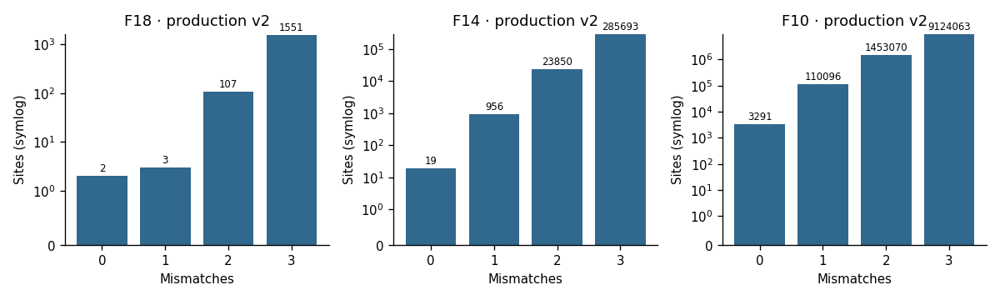
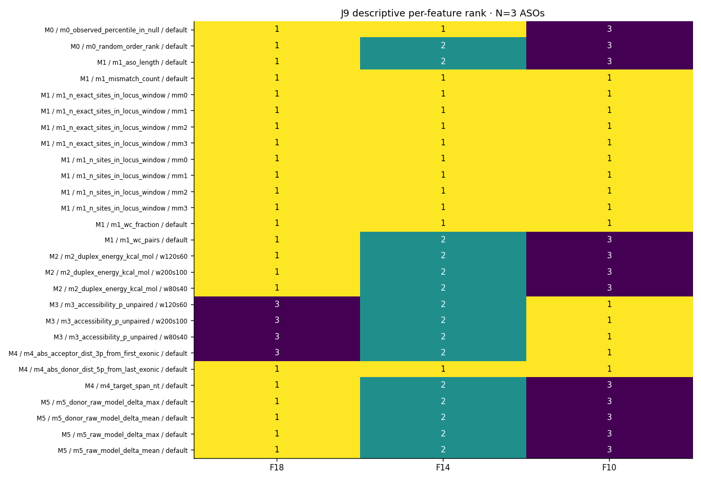
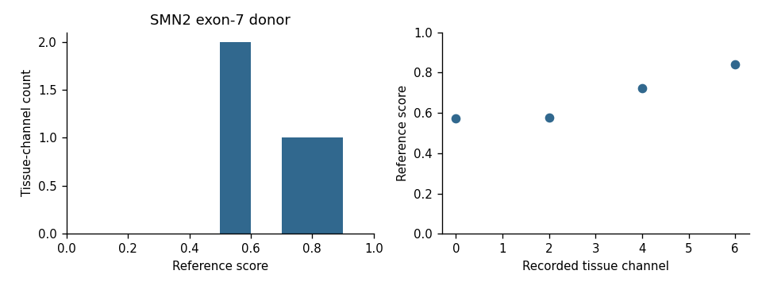
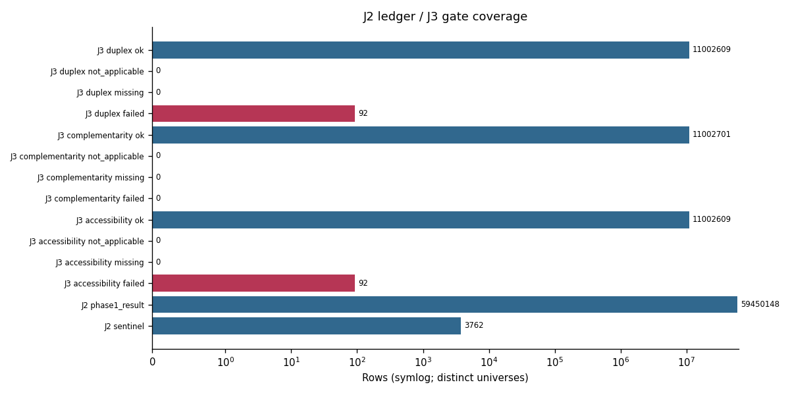

# J11 descriptive report

Predictor snapshot SHA256: `fd177917389205ad756daff46e222a81a5f6a1e895240c7925b9ed6e532a9f76`.

Future independent wet-lab comparison must be made against this snapshot. Already-seen July gels are NOT prospective validation.

## What exists

Ledger states are recorded history, not fresh Slurm queries. Gates are locked historical reports; large output bytes are not revalidated. Unknown totals are not_available. Current inputs: J5 v4, J8 genome v2, J10 off-target v2, J7/J9 v3. J10 v1 is stale and excluded.

| Family | Slurm IDs (all recorded stages) | Rows / units | Gate / status | Evidence class |
|---|---|---|---|---|
| J2 | 29159943, 29162809, 29162822, 29163480, 29166102, 29166103 | sentinel: 3762; phase1_result: 59450148 | ledger only; completion not independently authenticated | derived |
| J3 | 29166104, 29181966, 29186280, 29190031 | 11002701 | historical gate passed | derived / proxy / model_assumption |
| J4 | 29165682, 29167204, 29169335, 29186247, 29186278, 29186279, 29204876, 29207884 | 20395 complete / 20395 emitted configs; 4 donor reference rows | historical deep gate passed | derived / proxy |
| J5 | 29266905, 29274598, 29274599, 29274600, 29280193, 29280194, 29280195, 29280507, 29280508, 29280509, 29292355, 29292356, 29292357, 29292358, 29292359 | 11002701 rows / 52424 valid windows | j5_j6_v4 gate passed; embeddings BLOCKED | derived / not_available |
| J6 | 29164482, 29166984, 29168354, 29168376, 29168377, 29168378 | 11002701 | historical gate passed | derived |
| J7 | 29271719, 29271720, 29271721, 29303724, 29303726, 29303727, 29383227, 29383229, 29383235, 29383243, 29794068, 29794069, 29799681 | 11002701 | REVIEWED / ADVANCE; completion marker only; RBP join BLOCKED; writer overlap unverified | derived / unlabeled / not_available |
| J8 | 29242485, 29253489, 29261102 | 11002701 | genome v2 manifest; Slurm 29261102 COMPLETED (campaign record); payloads not rehashed | derived / proxy |
| J9 | 29198432, 29223600, 29228637, 29230958, 29303731, 29383229 | 132 ranks/stability rows; 233 feature rows (verified when read_dataset is used); 3 placed ASOs | REVIEWED / ADVANCE; features and ranks verified via read_dataset() | derived / proxy / model_assumption |
| J10 | 29242486, 29254990, 29254991, 29266568, 29266569, 29303729 | 11002701 input rows; 2292 aggregate rows | v2 REVIEWED / ADVANCE (bounded review); completeness: passed | derived / proxy / model_assumption |

J2 phase-2 total: not_available unless explicitly row-counted in the ledger; no total is inferred from task completion.

### Artifact citations (exact bytes)

- **brief_F1_RESULT**: `/home/dashii/smt-isef/conference/model_v2/ops/briefs/F1_RESULT.md` (SHA256 `f25da38dda267e752d117c16cf7b0e3e800f36e514aa7e6f634ce2906ea93a58`)
- **brief_F3_FIX2_RESULT**: `/home/dashii/smt-isef/conference/model_v2/ops/briefs/F3_FIX2_RESULT.md` (SHA256 `af42c872f3a754cc736bd46003abb13edeeb0b1f0522284d3294482a8e4e0437`)
- **brief_F3_FIX3_RESULT**: `/home/dashii/smt-isef/conference/model_v2/ops/briefs/F3_FIX3_RESULT.md` (SHA256 `dedbc117d661e6e7bcba88a7144eb882a321acece0c5f6041878031fa607266f`)
- **brief_F3_FIX4_RESULT**: `/home/dashii/smt-isef/conference/model_v2/ops/briefs/F3_FIX4_RESULT.md` (SHA256 `bd6fae64eb53b6e100ddbabec121da40808a871f45164542a8752ab4df498c1c`)
- **brief_F3_FIX5_RESULT**: `/home/dashii/smt-isef/conference/model_v2/ops/briefs/F3_FIX5_RESULT.md` (SHA256 `b966c6442be8e509e0f53de571f7f538271fbe013cec2b8310f175e5e75718e6`)
- **brief_F3_FIX_RESULT**: `/home/dashii/smt-isef/conference/model_v2/ops/briefs/F3_FIX_RESULT.md` (SHA256 `e5eac3a5add5a2b555d0ada01c7796d492f4c1dd1b7d6307b6b8b300172937dd`)
- **brief_F3_REREVIEW2_RESULT**: `/home/dashii/smt-isef/conference/model_v2/ops/briefs/F3_REREVIEW2_RESULT.md` (SHA256 `940ac7256d9933546bf5b251203e8016a3605132b2145c6fd85edcb830bce5dd`)
- **brief_F3_REREVIEW3_RESULT**: `/home/dashii/smt-isef/conference/model_v2/ops/briefs/F3_REREVIEW3_RESULT.md` (SHA256 `0d78dc5d63c513c3bf389e070491e1d72cd4f76e8015c007bbe1cc0ccb5a2b1c`)
- **brief_F3_REREVIEW4_RESULT**: `/home/dashii/smt-isef/conference/model_v2/ops/briefs/F3_REREVIEW4_RESULT.md` (SHA256 `bfef0dee24189a4e1008e13ab46a35a2987937900c0cd92f78857906be24d6d3`)
- **brief_F3_REREVIEW5_RESULT**: `/home/dashii/smt-isef/conference/model_v2/ops/briefs/F3_REREVIEW5_RESULT.md` (SHA256 `01dacf063b52ee61e2f8140cc5c362426ffe13281207b1ff027f2fa739b08767`)
- **brief_F3_REREVIEW_RESULT**: `/home/dashii/smt-isef/conference/model_v2/ops/briefs/F3_REREVIEW_RESULT.md` (SHA256 `b572161f297f94b1e0219b6e774df8a8a401dfa53e7a4e68a0ed872d34c981f5`)
- **brief_F3_RESULT**: `/home/dashii/smt-isef/conference/model_v2/ops/briefs/F3_RESULT.md` (SHA256 `c9a75d002ef839ad71fa4a0b289507789fdcaed81d3390943bd5f64e6c99cc12`)
- **brief_F3_REVIEW_RESULT**: `/home/dashii/smt-isef/conference/model_v2/ops/briefs/F3_REVIEW_RESULT.md` (SHA256 `2c5c9383762cc7d343593db55d5b8f52395ed44b355edb433f8e680bf67912cd`)
- **brief_J10OFF_FIX_RESULT**: `/home/dashii/smt-isef/conference/model_v2/ops/briefs/J10OFF_FIX_RESULT.md` (SHA256 `2a8e5501c55404d0503899e90a56759c21fd4977f38a29cc47d02e9624cc44ae`)
- **brief_J10OFF_REVIEW_RESULT**: `/home/dashii/smt-isef/conference/model_v2/ops/briefs/J10OFF_REVIEW_RESULT.md` (SHA256 `9aaae76bdbefc3de79767f7dd2d85df4d6a046a026c69b8f31674c990cccf14c`)
- **brief_J3_RESULT**: `/home/dashii/smt-isef/conference/model_v2/ops/briefs/J3_RESULT.md` (SHA256 `cdc5a451bffacf620599b91ffdd20c24e108942778965a47cf40dde0286cd0b5`)
- **brief_J4_DRIVER_RESULT**: `/home/dashii/smt-isef/conference/model_v2/ops/briefs/J4_DRIVER_RESULT.md` (SHA256 `81d30075c9ff4bbd95ce197ddd62736ce7d2fa330282beb210f38342f4f6d710`)
- **brief_J4_FIX_RESULT**: `/home/dashii/smt-isef/conference/model_v2/ops/briefs/J4_FIX_RESULT.md` (SHA256 `fdf2efc232998cf5590a2189129a851d901dd5ba64de76bfed6b5a2f48cf51f1`)
- **brief_J4_RESULT**: `/home/dashii/smt-isef/conference/model_v2/ops/briefs/J4_RESULT.md` (SHA256 `c4f0ccdce77cd18e79fff9e29f9dd5f23497139c9da33483037856d2118bf959`)
- **brief_J4_REVIEW_RESULT**: `/home/dashii/smt-isef/conference/model_v2/ops/briefs/J4_REVIEW_RESULT.md` (SHA256 `e1d72ecfcf88525d85044eeaf6969fe994d8eb8c2d85f05d3aa34610bf6b46de`)
- **brief_J4_SCALE_RESULT**: `/home/dashii/smt-isef/conference/model_v2/ops/briefs/J4_SCALE_RESULT.md` (SHA256 `6d345e5209fb92b628440e0439016cd81c444739f991dd32a007590f304e5070`)
- **brief_J5_FIX2_RESULT**: `/home/dashii/smt-isef/conference/model_v2/ops/briefs/J5_FIX2_RESULT.md` (SHA256 `346c9fa1b49c0d6fd56706b3772ce04c4c9ba9a8d504c613069b76303962e922`)
- **brief_J5_FIX3_RESULT**: `/home/dashii/smt-isef/conference/model_v2/ops/briefs/J5_FIX3_RESULT.md` (SHA256 `ea9b05b4ab5b83068f5276f202caefccbab77ee860f03e14ddd294621d8f25bb`)
- **brief_J5_FIX_RESULT**: `/home/dashii/smt-isef/conference/model_v2/ops/briefs/J5_FIX_RESULT.md` (SHA256 `9dd7688a543e3d6dc9ccbcf34dbcc948a6b0cb363ba0f2375f07ddbe2e99f305`)
- **brief_J5_LIFT_RESULT**: `/home/dashii/smt-isef/conference/model_v2/ops/briefs/J5_LIFT_RESULT.md` (SHA256 `c22640871023cc5c38a369c21c58f4e7b55dcc5a7485133395362d5c9e4eb6fe`)
- **brief_J5_REREVIEW2_RESULT**: `/home/dashii/smt-isef/conference/model_v2/ops/briefs/J5_REREVIEW2_RESULT.md` (SHA256 `e01a54032a9685abc5ea5f6f447ed9a71081b934e2edeebde3c3c2b3a6acbb4b`)
- **brief_J5_REREVIEW3_RESULT**: `/home/dashii/smt-isef/conference/model_v2/ops/briefs/J5_REREVIEW3_RESULT.md` (SHA256 `b19d2c25a0888960afb59eb0c05460d75510c0b34d0230473613b31a2ac57b21`)
- **brief_J5_REREVIEW_RESULT**: `/home/dashii/smt-isef/conference/model_v2/ops/briefs/J5_REREVIEW_RESULT.md` (SHA256 `bf4828f7b6858fec1f3f60a47d6d197881b3ac4f8fb7947e0b7c6d430e43f725`)
- **brief_J5_RESULT**: `/home/dashii/smt-isef/conference/model_v2/ops/briefs/J5_RESULT.md` (SHA256 `fbeb5937affe3363adeabed1e3f35b9dcccf3bbaa38d2974df8da7e561cfc667`)
- **brief_J5_REVIEW_RESULT**: `/home/dashii/smt-isef/conference/model_v2/ops/briefs/J5_REVIEW_RESULT.md` (SHA256 `10c60fb29678a73866505c8f60655b3b39f82312981449dcd737911f4fdd9e0e`)
- **brief_J6_FIX_RESULT**: `/home/dashii/smt-isef/conference/model_v2/ops/briefs/J6_FIX_RESULT.md` (SHA256 `11741f67ba6e6733450d237591cef5d658b527cdb6d24d0f8a0471b3b2e2faa1`)
- **brief_J6_REREVIEW_RESULT**: `/home/dashii/smt-isef/conference/model_v2/ops/briefs/J6_REREVIEW_RESULT.md` (SHA256 `1000aced06673f4c82be3e097c46750e4b92520f667c690afa0cefaa9a7f1133`)
- **brief_J6_RESULT**: `/home/dashii/smt-isef/conference/model_v2/ops/briefs/J6_RESULT.md` (SHA256 `168a5c9440bca4ac246e53440757a01f4fbd7fd086364c910d7a47f1db2d7fd9`)
- **brief_J6_REVIEW_RESULT**: `/home/dashii/smt-isef/conference/model_v2/ops/briefs/J6_REVIEW_RESULT.md` (SHA256 `6a32b9ad82f0c4d7e89d676c84c079723b15e4ab8f2d2d227c09fd74ebe63f70`)
- **brief_J7J9J10_REREVIEW_V2_RESULT**: `/home/dashii/smt-isef/conference/model_v2/ops/briefs/J7J9J10_REREVIEW_V2_RESULT.md` (SHA256 `3fba9fa068d11bd22185a372a548e42dc6de3096e6e94cb0e4077d0d8b3752e6`)
- **brief_J7J9_V3_REVIEW_RESULT**: `/home/dashii/smt-isef/conference/model_v2/ops/briefs/J7J9_V3_REVIEW_RESULT.md` (SHA256 `f9ebfb8f45ede0fa9c01da69663bbb4e74f77731d471628e964aceee0d798cb8`)
- **brief_J8J10_FIX_RESULT**: `/home/dashii/smt-isef/conference/model_v2/ops/briefs/J8J10_FIX_RESULT.md` (SHA256 `c90fa750d25a9cc228d4f738bdfb3fe64de478b67390e6948a5f0bb543ac16bc`)
- **brief_J8J10_REREVIEW_RESULT**: `/home/dashii/smt-isef/conference/model_v2/ops/briefs/J8J10_REREVIEW_RESULT.md` (SHA256 `20140da2b57e89904baee5d9e689587433d8383253256b0e6cea48775d49f38e`)
- **brief_J8J10_RESULT**: `/home/dashii/smt-isef/conference/model_v2/ops/briefs/J8J10_RESULT.md` (SHA256 `c456fcea0c27282fdd9a281e079362e2b85b67b31db24303045696ee0364da9d`)
- **brief_J8J10_REVIEW_RESULT**: `/home/dashii/smt-isef/conference/model_v2/ops/briefs/J8J10_REVIEW_RESULT.md` (SHA256 `c8173146e27b88b39cd040fab2d680eae4ccb11cc4973109a16fd4d499474be5`)
- **brief_J9_SMN2_RESULT**: `/home/dashii/smt-isef/conference/model_v2/ops/briefs/J9_SMN2_RESULT.md` (SHA256 `930e8863bc1731577114f300f02809b24dfcfadd11458a16f698fe6ddbfb34f1`)
- **brief_REVIEW_J7_J9_J10_RESULT**: `/home/dashii/smt-isef/conference/model_v2/ops/briefs/REVIEW_J7_J9_J10_RESULT.md` (SHA256 `5d50a96e845b0c36e3d384b65143c3e46d22223f14b72df5234371917f96f6a8`)
- **final_audit**: `/home/dashii/smt-isef/conference/model_v2/ops/FINAL_LAUNCH_AUDIT.md` (SHA256 `35d7ab44c8ceb110c354aafb1420b04ce42a4e25fd416ab87887747e8d9ccafb`)
- **j10_done**: `/home/dashii/orcd/scratch/feng/model_v2/j10_offtarget_v2/j10_profile.done` (SHA256 `7c3d33bef6872db7b5d1d0b8c7872ed3c3c1e1bb014e6660a40630cdd3867d6b`)
- **j10_profile**: `/home/dashii/orcd/scratch/feng/model_v2/j10_offtarget_v2/j10_profile.json` (SHA256 `3ab6e8787cea3ddda4bd4911a03e1120ae04d7465036516e0551d985a1af76ab`)
- **j3_gate**: `/home/dashii/orcd/scratch/feng/model_v2/j3_genome_v1/gate_report.json` (SHA256 `f6f1f45e8d2c70fc83f9032ad7a9d17af21e29b5c9fcc61847b4998fb16921f9`)
- **j4_done**: `/home/dashii/orcd/scratch/feng/model_v2/j4_atlas_v1/SMN2_exon7_issn1_fine/shard_0.done` (SHA256 `0c90a15ae9310634b9f1f17c5d0b830607211e8a52ec364fd4941b4f54649a79`)
- **j4_gate**: `/home/dashii/smt-isef/conference/model_v2/ops/briefs/j4_gate.json` (SHA256 `786a35b281151b2e2373765ef1b70404581aeb819c6faa888e3f3da974b952a7`)
- **j4_reference**: `/orcd/scratch/orcd/011/dashii/feng/model_v2/j4_atlas_v1/SMN2_exon7_issn1_fine/reference_scores/8a797ec48aa2834fcbc4487bc9e27a8695546b7a4eb88fbcb561034baa788464_e5681a291399378e67481ccc34aefc04178327c09133c9f88ccf6b070a657e2f.parquet` (SHA256 `b1be2ad7a978753bb9c428ffb850137632c57422713b3505b396e5bb9433d1b9`)
- **j5_gate**: `/home/dashii/orcd/scratch/feng/model_v2/j5_gate_v4.json` (SHA256 `624e6140cee8e457642c2ec69f5b4ba2db411a62bf7be9e6a7822560c59be035`)
- **j6_gate**: `/home/dashii/orcd/scratch/feng/model_v2/j6_genome_v1/gate_report.json` (SHA256 `31bc599df1c8cb20ff6b657464669deffa24990fb096a701a419584439de59b4`)
- **j7_done**: `/home/dashii/orcd/scratch/feng/model_v2/j7_context_v3/shards/j7_context.done` (SHA256 `c703b45bede2ce9baf12c18d72aff00fe41c7a869480af62a1ce4a671f270f91`)
- **j8_manifest**: `/home/dashii/orcd/scratch/feng/model_v2/j8_genome_v2/manifest.json` (SHA256 `8bbe9801ec47c6b9c51ed0691546884c2568e514885daf936d26f6b0db4bbcf7`)
- **j9_features**: `/orcd/scratch/orcd/011/dashii/feng/model_v2/j9_smn2_v3/.generations/cdabf4bae9c3b32f42032fe6b282aa32da61391fb2432ddeeb6983808fb04872/features.parquet` (SHA256 `c3f0367e3b4065d84ad5c4c75f524641307b88ac86907bf90cb138fb3c39ac0a`)
- **j9_manifest**: `/orcd/scratch/orcd/011/dashii/feng/model_v2/j9_smn2_v3/.generations/cdabf4bae9c3b32f42032fe6b282aa32da61391fb2432ddeeb6983808fb04872/manifest.json` (SHA256 `cdabf4bae9c3b32f42032fe6b282aa32da61391fb2432ddeeb6983808fb04872`)
- **j9_ranks**: `/orcd/scratch/orcd/011/dashii/feng/model_v2/j9_smn2_v3/.generations/cdabf4bae9c3b32f42032fe6b282aa32da61391fb2432ddeeb6983808fb04872/ranks.parquet` (SHA256 `c84338477fbada6d44ec233c7cdb4f27a961b2515d8f2951ef7ef3507cd508b0`)
- **j9_readme**: `/orcd/scratch/orcd/011/dashii/feng/model_v2/j9_smn2_v3/.generations/cdabf4bae9c3b32f42032fe6b282aa32da61391fb2432ddeeb6983808fb04872/README.md` (SHA256 `4151b6d6f4dfc94f0a425b1eb17e53df3bd02a099426edaa59a30812eb6fb583`)
- **jobs**: `/home/dashii/smt-isef/conference/model_v2/ops/JOBS.jsonl` (SHA256 `a1883cd5fa5f75b66d0981dad3ecc3549186c7376f437ac2b3e07a3a638fcc3c`)
- **next_action**: `/home/dashii/smt-isef/conference/model_v2/ops/NEXT_ACTION.json` (SHA256 `98d7c2ece275a12a30c4b52d9af4052dbbcf80c25a8179c8f3b85a8c330db933`)
- **review_v3**: `/home/dashii/smt-isef/conference/model_v2/ops/briefs/J7J9_V3_REVIEW_RESULT.md` (SHA256 `f9ebfb8f45ede0fa9c01da69663bbb4e74f77731d471628e964aceee0d798cb8`)
- **scientific_lock**: `/home/dashii/smt-isef/conference/model_v2/SCIENTIFIC_LOCK.md` (SHA256 `fa9034066e611138d4299345d40235b190a5c6c5eec238a959682f1b61bb5465`)
- **source_j10**: `/home/dashii/smt-isef/conference/model_v2/j10_offtarget_profile.py` (SHA256 `e6163a53788c4288736e8390bbcf382558b38188bb9b4591858943d7cc1a86e8`)
- **source_j10_robustness**: `/home/dashii/smt-isef/conference/model_v2/j10_robustness.py` (SHA256 `53bd3c69d1ddb2ea9df73fa022590636c8557828411b54dd3813c9401225a84a`)
- **source_j3**: `/home/dashii/smt-isef/conference/model_v2/j3_scoring.py` (SHA256 `93614579945832ddde19443b7b15e8dbe0390cb6ce2002f7529c1fb2a1d5eb6f`)
- **source_j4**: `/home/dashii/smt-isef/conference/model_v2/gpu_perturbation_atlas.py` (SHA256 `840400b13131949c6182fbb2632ace376e6a87f930991ce2790e6e5683e849f5`)
- **source_j4_configs**: `/home/dashii/smt-isef/conference/model_v2/j4_build_configs.py` (SHA256 `70dc7c30c5040e294aa3a6f568a4dca88c74cb2cd284fcdbeeec3bc22bc904f2`)
- **source_j6**: `/home/dashii/smt-isef/conference/model_v2/j6_site_universe.py` (SHA256 `f97c2cf1aff195284bb01b69cb6c5558d4397b48c86f5558485a0ab3efc4f053`)
- **source_j7**: `/home/dashii/smt-isef/conference/model_v2/j7_context_features.py` (SHA256 `a419389b637251f7ef34a1ff28b24f3e241f84e8735427c5563568125f3d2c79`)
- **source_j9**: `/home/dashii/smt-isef/conference/model_v2/j9_smn2_prediction.py` (SHA256 `c4ae2025fcbafefd0fabb58745804c2cd4c0573ff4ad3d9b7749a94bf163ecaf`)
- **source_report**: `/home/dashii/smt-isef/conference/model_v2/j11_report.py` (SHA256 `62db242c7a810559b31cf81aa71cb15b33f0a799e58f65f64c241ba52494e7b6`)
- **usage_ledger**: `/home/dashii/smt-isef/conference/model_v2/ops/USAGE_LEDGER.jsonl` (SHA256 `6fb583c5c80e09587acc19290ea871cc3c33d20b3de33123851fb7ceb0e1106f`)
- **wetlab_manifest**: `/home/dashii/smt-isef/conference/model_v2/ops/WETLAB_MANIFEST.json` (SHA256 `02e32bb01611ddf8e4e506f6771cadd09319c45b151df120d0185bf16caea23b`)
- **wetlab_readme_metadata_only**: `/home/dashii/smt-isef/conference/model_v2/wetlab/README.md` (SHA256 `1a7be4034cbfa8e673884cc75a2703fe24ef8e0db2e850431e814774fa9e4dc4`)

J7 completion-marker output SHA256 is a producer-recorded claim, not reverified large parquet bytes: `660d2b64dfe0ece820ee3e4238ccefe03393d03da59aa6486d126bf3e115cebe`. No large J7 parquet is cited as byte-verified.

## What outputs support and do not support

- **J2** (derived): supports Locus-window enumeration and accessibility coverage. Does not support: No whole-genome completeness or modified-ASO efficacy; stage counts have different universes.
- **J3** (derived / proxy / model_assumption): supports Sequence complementarity, RNA duplex energy and accessibility with explicit channel failures. Does not support: No potency or measured occupancy; failed rows remain failed.
- **J4** (derived / proxy): supports Reference splice-model outputs and N-mask sequence_ablation_proxy. Does not support: No measured splicing change or ASO mechanism; tissues are model channels, not replicates.
- **J5** (derived / not_available): supports v4 gate records RBP-context output; authenticated embeddings are absent. Does not support: No usable RBP join or supervised feature claim.
- **J6** (derived): supports GRCh38 / GENCODE v50 gene-body sequence-site enumeration, F18/F14/F10, mismatch 0–3. Does not support: No intergenic completeness, placed 3UP8, expression or activity label.
- **J7** (derived / unlabeled / not_available): supports Canonical-transcript geometry and unlabeled matched controls; completion-marker metadata only. Does not support: RBP join is blocked; isoform sensitivity and negative labels are unavailable.
- **J8** (derived / proxy): supports Genome v2 join manifest records full coverage and explicit missing channels. Does not support: No validated joint score; J2 exact footprint matching only, with 10/14 nt unavailable.
- **J9** (derived / proxy / model_assumption): supports Descriptive M0–M5 per-feature ordering for three placed ASOs and recorded alternatives. Does not support: No outcome labels, fitted predictor, efficacy test, or placed 3UP8.
- **J10** (derived / proxy / model_assumption): supports Production v2 site counts by mismatch; sequence counts include SMN anchors. Does not support: v1 is stale and excluded. v2 review is bounded; no risk or safety claim.

Review limits: J7 shard writers are not locked through merge consumption; production writer overlap was not independently verified. J9 FASTA identity uses path/size/mtime and FAI hash, not a full FASTA hash. Review verdicts are not scientific certification.

J3 channel status counts (failed computations remain explicit):

```json
{
  "accessibility": {
    "failed": 92,
    "missing": 0,
    "not_applicable": 0,
    "ok": 11002609
  },
  "complementarity": {
    "failed": 0,
    "missing": 0,
    "not_applicable": 0,
    "ok": 11002701
  },
  "duplex": {
    "failed": 92,
    "missing": 0,
    "not_applicable": 0,
    "ok": 11002609
  }
}
```

## Evidence boundary

- **observed**: File existence, recorded run metadata, or supplied measurement; no wet-lab measurements enter this package.
- **derived**: Deterministic sequence, geometry, count, rank or reference-model computation; no efficacy label.
- **proxy**: Accessibility and N-masking sequence_ablation_proxy; neither occupancy nor a measured splicing change.
- **model_assumption**: Unmodified-RNA duplex thermodynamics; chemistry and cellular context are not modeled.
- **unlabeled**: No verified outcome class, including matched/scrambled controls; not a negative label.
- **not_available**: Missing, failed, blocked or undefined quantities stay explicit; never filled with zero.

## Blocked list

- M6 undefined: no supervised model or efficacy endpoint is available.
- RBP join: BLOCKED pending verified GRCh38 peak bytes, liftover chain hash and mapping QC.
- J5 embeddings: BLOCKED / not_available; no embedding output is authenticated here.
- Supervised training: BLOCKED; no verified negatives. Responders and matched controls do not supply negatives.
- 3UP8 unplaced: needs human confirmation; excluded from the three-ASO ranks.
- ASO chemistry unknown; unmodified-RNA energies do not establish modified-ASO binding or potency.
- SMN coordinates are derived, not GTF-confirmed; paralogs must remain separate.
- July exon-7 gels were previously seen; no prospective claim; excluded from fitting, selection and joins.
- The exon 3 audit is exploratory only; no training, tuning, selection or exon-7 inference.

## Descriptive figures



Evidence class: derived. Production J10 v2 sites by mismatch, per ASO, summed across disjoint scopes once per threshold-independent bin (including SMN anchors). Limitation: gene-specific site identifiers, not unique genome coordinates; no activity or safety inference; reviewed v2 is descriptive only.



Evidence class: derived / proxy / model_assumption, inherited per feature. Descriptive ordinal ranks over three ASOs; each feature/alternative stays separate. Limitation: no verified negatives or outcome labels; ranks are not efficacy estimates; blank cells mean not_available.



Evidence class: derived. Pangolin reference-score distribution at the SMN2 exon-7 donor (last exonic base) across recorded tissue channels. Limitation: tissue channels are not independent experimental replicates; coordinates are derived, not GTF-confirmed; no measured splicing change.



Evidence class: derived. J2 ledger stage rows and J3 gate channel counts. Limitation: distinct stage/universe denominators; missing ledger totals are not_available, not zero; channel failures are retained; no cross-stage coverage fraction is implied.

## J9 baseline rank table

| Baseline | Feature | Alternative | ASO | Rank | Evidence class | Status |
|---|---|---|---|---|---|---|
| M0 | m0_observed_percentile_in_null | default | F10 | 3 | derived | ok |
| M0 | m0_observed_percentile_in_null | default | F14 | 1 | derived | ok |
| M0 | m0_observed_percentile_in_null | default | F18 | 1 | derived | ok |
| M0 | m0_random_order_rank | default | F10 | 3 | derived | ok |
| M0 | m0_random_order_rank | default | F14 | 2 | derived | ok |
| M0 | m0_random_order_rank | default | F18 | 1 | derived | ok |
| M1 | m1_aso_length | default | F10 | 3 | derived | ok |
| M1 | m1_aso_length | default | F14 | 2 | derived | ok |
| M1 | m1_aso_length | default | F18 | 1 | derived | ok |
| M1 | m1_mismatch_count | default | F10 | 1 | derived | ok |
| M1 | m1_mismatch_count | default | F14 | 1 | derived | ok |
| M1 | m1_mismatch_count | default | F18 | 1 | derived | ok |
| M1 | m1_n_exact_sites_in_locus_window | mm0 | F10 | 1 | derived | ok |
| M1 | m1_n_exact_sites_in_locus_window | mm0 | F14 | 1 | derived | ok |
| M1 | m1_n_exact_sites_in_locus_window | mm0 | F18 | 1 | derived | ok |
| M1 | m1_n_exact_sites_in_locus_window | mm1 | F10 | 1 | derived | ok |
| M1 | m1_n_exact_sites_in_locus_window | mm1 | F14 | 1 | derived | ok |
| M1 | m1_n_exact_sites_in_locus_window | mm1 | F18 | 1 | derived | ok |
| M1 | m1_n_exact_sites_in_locus_window | mm2 | F10 | 1 | derived | ok |
| M1 | m1_n_exact_sites_in_locus_window | mm2 | F14 | 1 | derived | ok |
| M1 | m1_n_exact_sites_in_locus_window | mm2 | F18 | 1 | derived | ok |
| M1 | m1_n_exact_sites_in_locus_window | mm3 | F10 | 1 | derived | ok |
| M1 | m1_n_exact_sites_in_locus_window | mm3 | F14 | 1 | derived | ok |
| M1 | m1_n_exact_sites_in_locus_window | mm3 | F18 | 1 | derived | ok |
| M1 | m1_n_sites_in_locus_window | mm0 | F10 | 1 | derived | ok |
| M1 | m1_n_sites_in_locus_window | mm0 | F14 | 1 | derived | ok |
| M1 | m1_n_sites_in_locus_window | mm0 | F18 | 1 | derived | ok |
| M1 | m1_n_sites_in_locus_window | mm1 | F10 | 1 | derived | ok |
| M1 | m1_n_sites_in_locus_window | mm1 | F14 | 1 | derived | ok |
| M1 | m1_n_sites_in_locus_window | mm1 | F18 | 1 | derived | ok |
| M1 | m1_n_sites_in_locus_window | mm2 | F10 | 1 | derived | ok |
| M1 | m1_n_sites_in_locus_window | mm2 | F14 | 1 | derived | ok |
| M1 | m1_n_sites_in_locus_window | mm2 | F18 | 1 | derived | ok |
| M1 | m1_n_sites_in_locus_window | mm3 | F10 | 1 | derived | ok |
| M1 | m1_n_sites_in_locus_window | mm3 | F14 | 1 | derived | ok |
| M1 | m1_n_sites_in_locus_window | mm3 | F18 | 1 | derived | ok |
| M1 | m1_wc_fraction | default | F10 | 1 | derived | ok |
| M1 | m1_wc_fraction | default | F14 | 1 | derived | ok |
| M1 | m1_wc_fraction | default | F18 | 1 | derived | ok |
| M1 | m1_wc_pairs | default | F10 | 3 | derived | ok |
| M1 | m1_wc_pairs | default | F14 | 2 | derived | ok |
| M1 | m1_wc_pairs | default | F18 | 1 | derived | ok |
| M2 | m2_duplex_energy_kcal_mol | w120s60 | F10 | 3 | model_assumption | ok |
| M2 | m2_duplex_energy_kcal_mol | w120s60 | F14 | 2 | model_assumption | ok |
| M2 | m2_duplex_energy_kcal_mol | w120s60 | F18 | 1 | model_assumption | ok |
| M2 | m2_duplex_energy_kcal_mol | w200s100 | F10 | 3 | model_assumption | ok |
| M2 | m2_duplex_energy_kcal_mol | w200s100 | F14 | 2 | model_assumption | ok |
| M2 | m2_duplex_energy_kcal_mol | w200s100 | F18 | 1 | model_assumption | ok |
| M2 | m2_duplex_energy_kcal_mol | w80s40 | F10 | 3 | model_assumption | ok |
| M2 | m2_duplex_energy_kcal_mol | w80s40 | F14 | 2 | model_assumption | ok |
| M2 | m2_duplex_energy_kcal_mol | w80s40 | F18 | 1 | model_assumption | ok |
| M3 | m3_accessibility_p_unpaired | w120s60 | F10 | 1 | proxy | ok |
| M3 | m3_accessibility_p_unpaired | w120s60 | F14 | 2 | proxy | ok |
| M3 | m3_accessibility_p_unpaired | w120s60 | F18 | 3 | proxy | ok |
| M3 | m3_accessibility_p_unpaired | w200s100 | F10 | 1 | proxy | ok |
| M3 | m3_accessibility_p_unpaired | w200s100 | F14 | 2 | proxy | ok |
| M3 | m3_accessibility_p_unpaired | w200s100 | F18 | 3 | proxy | ok |
| M3 | m3_accessibility_p_unpaired | w80s40 | F10 | 1 | proxy | ok |
| M3 | m3_accessibility_p_unpaired | w80s40 | F14 | 2 | proxy | ok |
| M3 | m3_accessibility_p_unpaired | w80s40 | F18 | 3 | proxy | ok |
| M4 | m4_abs_acceptor_dist_3p_from_first_exonic | default | F10 | 1 | derived | ok |
| M4 | m4_abs_acceptor_dist_3p_from_first_exonic | default | F14 | 2 | derived | ok |
| M4 | m4_abs_acceptor_dist_3p_from_first_exonic | default | F18 | 3 | derived | ok |
| M4 | m4_abs_donor_dist_5p_from_last_exonic | default | F10 | 1 | derived | ok |
| M4 | m4_abs_donor_dist_5p_from_last_exonic | default | F14 | 1 | derived | ok |
| M4 | m4_abs_donor_dist_5p_from_last_exonic | default | F18 | 1 | derived | ok |
| M4 | m4_target_span_nt | default | F10 | 3 | derived | ok |
| M4 | m4_target_span_nt | default | F14 | 2 | derived | ok |
| M4 | m4_target_span_nt | default | F18 | 1 | derived | ok |
| M5 | m5_donor_raw_model_delta_max | default | F10 | 3 | proxy | ok |
| M5 | m5_donor_raw_model_delta_max | default | F14 | 2 | proxy | ok |
| M5 | m5_donor_raw_model_delta_max | default | F18 | 1 | proxy | ok |
| M5 | m5_donor_raw_model_delta_mean | default | F10 | 3 | proxy | ok |
| M5 | m5_donor_raw_model_delta_mean | default | F14 | 2 | proxy | ok |
| M5 | m5_donor_raw_model_delta_mean | default | F18 | 1 | proxy | ok |
| M5 | m5_raw_model_delta_max | default | F10 | 3 | proxy | ok |
| M5 | m5_raw_model_delta_max | default | F14 | 2 | proxy | ok |
| M5 | m5_raw_model_delta_max | default | F18 | 1 | proxy | ok |
| M5 | m5_raw_model_delta_mean | default | F10 | 3 | proxy | ok |
| M5 | m5_raw_model_delta_mean | default | F14 | 2 | proxy | ok |
| M5 | m5_raw_model_delta_mean | default | F18 | 1 | proxy | ok |

## Regeneration

Use the locked generator command in REPRODUCE.md. Missing artifacts, source drift, or git HEAD drift fail before publication. External weights and genome data are not read. This snapshot does not certify that all historical producers match current source versions. Wet-lab audit documentation is cited by path/hash only; no wet-lab numeric data are reproduced.
